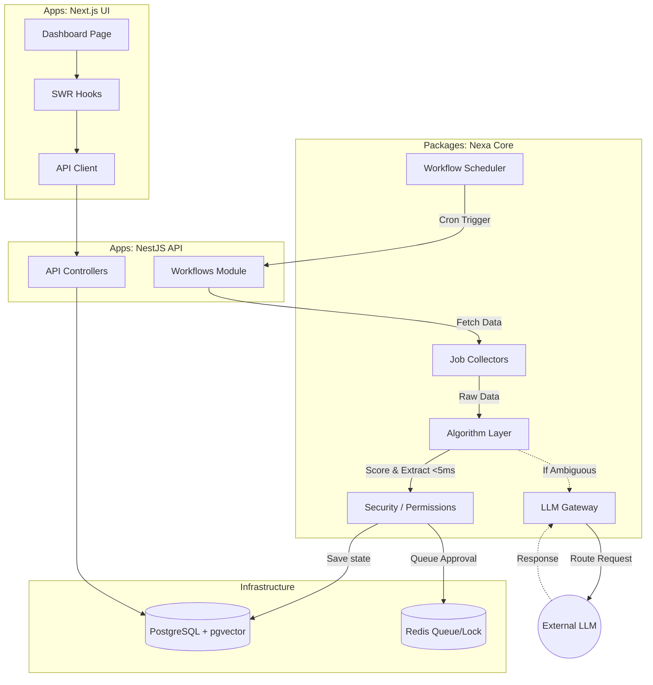

# Nexa Version 1.0 - Current Codebase Status

This document provides a comprehensive, end-to-end analysis of the Nexa codebase as it currently stands. It details the file structure, application flow, what has been accomplished, our original goals, and what remains to be done.

---

## 1. Our Goal

The goal was to build **Nexa**, a highly autonomous, multi-agent AI workforce platform with the following core tenets:
1. **Algorithm-First Architecture**: Maximize deterministic code (algorithms) and minimize expensive LLM calls. >70% of operations should run on pure code ($0 cost, <5ms).
2. **Detachable LLM Gateway**: A robust, swappable LLM provider system (Ollama, Groq, OpenRouter) with zero-LLM template fallbacks to guarantee uptime.
3. **Enterprise-Grade Monorepo**: Built using Turborepo, NestJS (Backend), Next.js (Frontend), and PostgreSQL (with pgvector for memory).
4. **Agentic Capabilities**: Autonomous job searching, application processing, business creation, and system self-repair, all governed by a strict 5-tier permission system (human-in-the-loop).

---

## 2. Codebase File Structure

The project is structured as a Turborepo monorepo. Here is the high-level architecture:

```text
Nexa-workspace/
├── apps/
│   ├── api/                  # NestJS Backend API (Port 3001)
│   │   ├── prisma/           # Prisma schema (links to packages/database)
│   │   └── src/              # Controllers and App Modules linking packages
│   └── web/                  # Next.js Frontend Dashboard (Port 3000)
│       └── src/
│           ├── app/          # Next.js App Router (Dashboard, Settings, Insights)
│           ├── components/   # UI Components (Sidebar, JobCard, AgentKanban)
│           └── lib/          # API Clients and SWR Hooks
├── packages/                 # 27 Modular Core Packages
│   ├── agent-runtime/        # Background queue and durable execution runner
│   ├── agents/               # Specific agents (business, application, self-repair)
│   ├── algorithms/           # Pure TS algorithms (scoring, extraction, normalization)
│   ├── approvals/            # Human-in-the-loop approval logic
│   ├── ats-adapters/         # Adapters for Greenhouse, Lever, etc.
│   ├── channels/             # Gmail adapter, Telegram bot integrations
│   ├── credentials/          # Secret management broker
│   ├── database/             # Prisma client and DatabaseService
│   ├── enrichment/           # Email finders, DNS MX checkers
│   ├── events/               # Event bus and immutable audit logging
│   ├── execution-engine/     # Plan compilation and budget middleware
│   ├── job-collectors/       # Scrapers (Greenhouse, Lever, YC, GitHub, Naukri)
│   ├── job-pipeline/         # Decision engine and data normalization
│   ├── jobs/                 # Core job domain types
│   ├── learning/             # Outcome trackers (reply rates, success scoring)
│   ├── llm/                  # Gateway, prompt cache, quota manager, providers
│   ├── memory/               # pgvector hybrid retriever, entity resolver
│   ├── notifications/        # Edge-TTS audio briefings
│   ├── observability/        # Pino JSON logger and metrics counters
│   ├── permissions/          # 5-tier permission guard
│   ├── profile/              # User profile CRUD
│   ├── resume/               # Resume tailoring and synonym rotation
│   ├── security/             # Untrusted content wrapper to prevent prompt injection
│   ├── shared/               # Shared types and utilities
│   ├── tools/                # Tool registry (calculator, scraper, etc.)
│   ├── validation/           # Data validation pipelines
│   └── workflows/            # Schedulers, crons (daily scan, CV optimizer)
├── docker-compose.yml        # PostgreSQL + pgvector container config
├── turbo.json                # Turborepo build pipeline
└── package.json              # Root npm workspaces config
```

---

## 3. Application Flow Diagram

The following diagram illustrates how the components interact from the moment a scheduled workflow fires to the UI rendering the result.



---

## 4. What We Have Done (Current Context)

We have successfully engineered and verified the entire backend architecture (Phases 0 through 10). 

### Fully Completed & Working:
1. **Infrastructure & Data**: PostgreSQL with `pgvector` is running via Docker. Prisma schemas are successfully pushed and generated.
2. **Backend API (`apps/api`)**: The NestJS server is online (Port 3001). All 27 internal packages are wired into the NestJS modules.
3. **The LLM Gateway (`packages/llm`)**: Dynamic routing across Ollama, Groq, OpenRouter, and a deterministic template fallback. It includes Redis quota tracking and prompt caching.
4. **The Algorithm Layer (`packages/algorithms`)**: Highly efficient extraction, scoring, and deduplication running without LLMs.
5. **Agents & Workflows (`packages/agents`, `packages/workflows`)**: Business creation pipelines, daily job scans, and system self-repair agents are fully coded.
6. **Security & Approvals (`packages/permissions`, `packages/security`)**: Untrusted data wrappers and a 5-tier permission guard ensure the AI cannot take consequential actions (like sending emails) without human approval.
7. **Frontend Scaffolding (`apps/web`)**: The Next.js dashboard renders the Executive Matrix, Kanban Board, LLM usage stats, and Job Cards.

---

## 5. Where We Are Currently

The platform is **live locally**, but the **Frontend UI is only partially complete**.

### The "Hardcoded" Illusion
When you open `http://localhost:3000/`, the dashboard looks like it has hardcoded data (Stripe, Vercel, Linear). 
* **Reality**: The frontend is properly making API calls to the backend via `useJobs()`. However, because your local database is currently empty (no background scans have been run yet), the code gracefully falls back to displaying `sampleFallbackJobs` so the UI doesn't look broken. 

### The Missing Pages (404 Errors)
The sidebar navigation menu includes links to `/tasks`, `/approvals`, `/memory`, and `/history`.
* **Reality**: These pages have not been coded yet. The files (`apps/web/src/app/tasks/page.tsx`, etc.) simply do not exist. Clicking on them naturally results in a Next.js 404 error.

---

## 6. What We Should Do to Achieve Our Goal

To bring Nexa to 100% completion (V1.0), we need to execute the following steps:

1. **Build the Missing Frontend Pages**:
   * Create `apps/web/src/app/tasks/page.tsx` to view active background jobs.
   * Create `apps/web/src/app/approvals/page.tsx` to allow you to click "Approve" or "Reject" on agent actions.
   * Create `apps/web/src/app/memory/page.tsx` to view the vector database records.
   * Create `apps/web/src/app/history/page.tsx` to view the immutable audit log.
2. **Wire the UI to the API**: Connect the approval buttons and task lists to the existing NestJS backend endpoints.
3. **Populate Real Data**: Execute the `daily-job-scan.workflow` via the API to scrape real jobs, which will instantly replace the fallback data on the dashboard with live, algorithm-scored opportunities.
4. **Final E2E UI Test**: Verify that approving a task in the UI correctly triggers the execution engine in the backend.

*This concludes the current status report of the Nexa codebase.*
