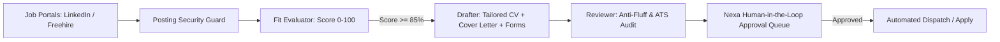

# AI-Job-Search Integration Plan (Nexa V3)

> Full architectural plan available at: [docs/ai-job-search/PLAN.md](docs/ai-job-search/PLAN.md)

---

## Quick Architecture Summary

### 100% Free Stack
- **Drafting & Forms**: Groq Cloud (`llama-3.1-8b-instant`) — Free 6,000 req/day.
- **Deep Evaluation**: OpenRouter (`deepseek-r1:free`, `qwen-2.5-72b:free`).
- **Embeddings**: Local ONNX `all-MiniLM-L6-v2` (Zero API calls).
- **Database**: Supabase PostgreSQL + `pgvector` (Free Tier).
- **Queues**: Local Docker Redis (Free).

### Key Features Unlocked
1. **Multi-Portal Scraping**: LinkedIn, Freehire, and niche boards via lightweight CLIs.
2. **Posting Injection Guard**: Sanitizes hidden zero-width unicode and prompt-injection traps.
3. **Drafter-Reviewer Agent**: Generates targeted CVs, cover letters, and portal form responses ("Tell us about yourself", STAR summaries).
4. **ATS Verification**: Ensures 90%+ ATS parseability before human approval.
5. **Human-in-the-Loop Gate**: Cryptographic SHA-256 approval cards in the Nexa Command Center UI.

Please refer to [`docs/AI_JOB_SEARCH_INTEGRATION_PLAN.md`](docs/AI_JOB_SEARCH_INTEGRATION_PLAN.md) for the complete implementation sprints, Gantt chart, and code mappings.
